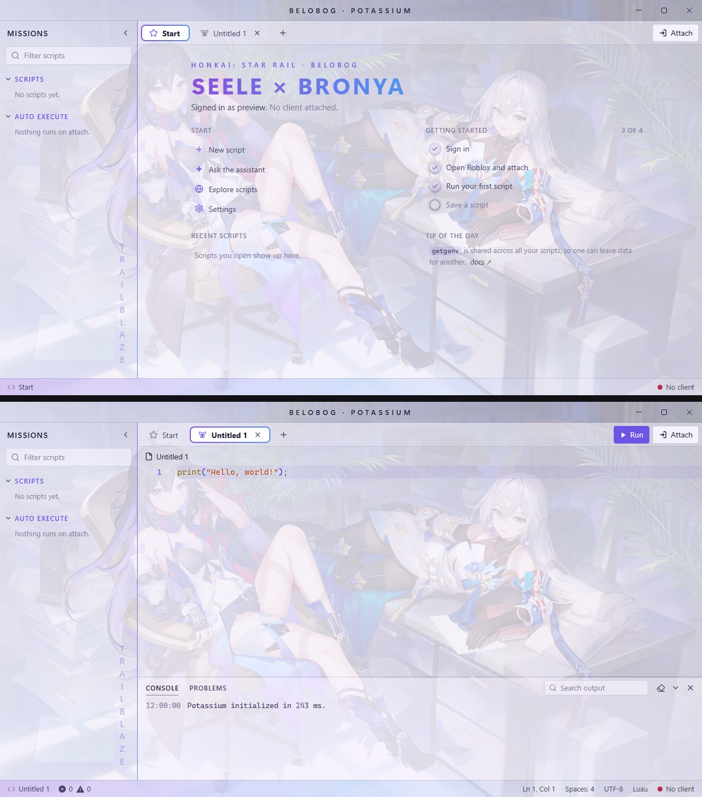
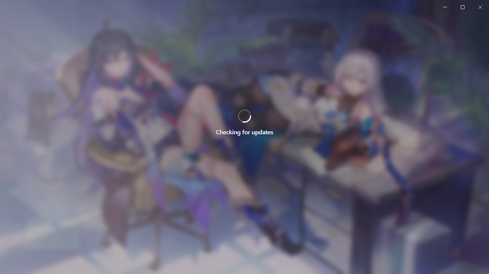

# Honkai: Star Rail theme for Potassium

An animated Honkai: Star Rail theme (Seele and Bronya) for the Potassium executor. Lavender glass with Seele-violet to Bronya-blue gradients and thin trailblazer lines. A looping wallpaper plays behind the whole app.

Previews are animated (AVIF) and show the Start page, a script tab and the loading screen at full size. Browsers that can't play AVIF show a still screenshot instead.

<picture>
  <source srcset="ui.avif" type="image/avif">
  
</picture>

<picture>
  <source srcset="loading.avif" type="image/avif">
  
</picture>

## Install

1. In Potassium, open **Settings → Appearance → Custom theme**.
2. Set **Base theme** to **Light**. The editor's syntax colours come from the base theme.
3. Copy everything in [`Theme.css`](Theme.css) and paste it into **Custom CSS**.
4. Type a name under **Save** and click **Save**.

## Loading screen

The theme also replaces Potassium's own loading and login picture with its wallpaper, softly blurred, so the theme starts the moment the app opens (shown above, under the main preview).

## Notes

- Wallpapers are animated AVIF files loaded from this repo, so you need internet the first time. If a wallpaper can't load, the colours still apply.
- Potassium cuts custom CSS off at 50,000 characters. This theme is about 6,500, so there's room for your own tweaks.
- The layouts target Potassium's internal class names. A future Potassium update could rename them; if that happens, the colours keep working but some layout touches may not.

## Credits

Honkai: Star Rail, Seele and Bronya belong to HoYoverse. The wallpaper is converted from a live wallpaper posted on [WallpaperWaifu](https://wallpaperwaifu.com):
[Seele and Bronya](https://wallpaperwaifu.com/anime/seele-and-bronya-honkai-star-rail-live-wallpaper-2088/).
